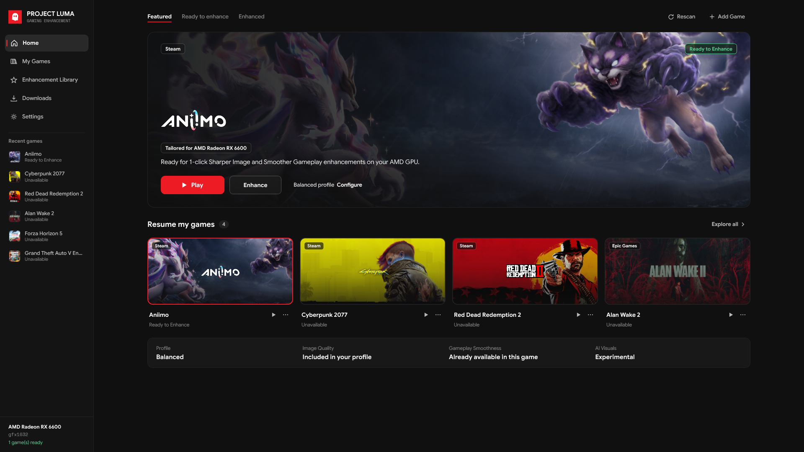

# Project Luma v3.3.2

**Project Luma** is a lightweight, Windows-native AMD gaming enhancement launcher built for Radeon GPUs across **RDNA 1, RDNA 2, RDNA 3, and RDNA 4**. It detects your AMD hardware, discovers games across 8 PC storefronts, configures compatible upscaling and frame-generation profiles with SHA-256 backups, verifies external NeuralHub `v0.9.0` integrations cleanly, and keeps itself updated from official GitHub Releases.



---

## What Was Fixed & Added in `v3.3.2`

- **Manual Check for Updates & Full 9-State Updater Workflow (`Downloads & Updates`):** Clearly separates Project Luma application updates from enhancement components, shows GitHub Release notes and SHA-256 / publisher verification status, supports explicit **Check for Updates**, **Download & Install Update**, and **Cancel** actions without freezing the UI, and tracks all nine update states cleanly through out-of-process `ProjectLuma.Updater.exe` restart and rollback protection.
- **Custom Game Persistence, Deduplication & Disconnected Drive Support:** Persists manually added `.exe` games, custom install locations, and custom artwork directly in SQLite (`luma.db`) via a shared `GameLibraryMerger` repository, deduplicates against store/folder scans, preserves entries on temporarily disconnected drives as **Unavailable** instead of deleting them, and restores availability automatically when reconnected.
- **Game Artwork & Selection Border Corner Clipping Fix:** Uses `RoundedClip` geometry with shared card corner radii (`RadiusGameCard`, `RadiusHero`, `RadiusBadge`) and a crisp non-hit-tested overlay outline so cover artwork, placeholder surfaces, hover states, and red selected borders align without corner bleed across resolutions and DPI scaling.
- **Prior `v3.3.1` & `v3.3.0` Capabilities Retained:** External NeuralHub `v0.9.0` detection & Vault SHA-256 sync, OptiScaler proxy conflict protection, dedicated NVIDIA DLL import, 7-stage AI Visuals discovery, persistent FSR quality presets (`OptiScaler.ini`), truthful Gameplay Smoothness states, and Windows System Tray + Startup Run sync.

---

## Documentation & Guides

- User Manual: [PROJECT_LUMA_USER_GUIDE.md](docs/PROJECT_LUMA_USER_GUIDE.md)
- Patch `v3.3.2` Engineering & Test Notes: [CUSTOM_GAME_PERSISTENCE_TEST.md](docs/CUSTOM_GAME_PERSISTENCE_TEST.md), [GAME_ARTWORK_CLIPPING_FIX.md](docs/GAME_ARTWORK_CLIPPING_FIX.md), [LIVE_UPDATE_TEST_REPORT.md](docs/LIVE_UPDATE_TEST_REPORT.md)
- NeuralHub Integration & Setup: [NEURALHUB_INTEGRATION_DIAGNOSIS.md](docs/NEURALHUB_INTEGRATION_DIAGNOSIS.md), [NEURALHUB_AND_DLL_SETUP_GUIDE.md](docs/NEURALHUB_AND_DLL_SETUP_GUIDE.md), [NEURALHUB_DLL_IMPORT_GUIDE.md](docs/NEURALHUB_DLL_IMPORT_GUIDE.md)
- Feature Engineering Notes: [FRAME_GENERATION_STATE.md](docs/FRAME_GENERATION_STATE.md), [SYSTEM_TRAY_VERIFICATION.md](docs/SYSTEM_TRAY_VERIFICATION.md), [WINDOWS_STARTUP_VERIFICATION.md](docs/WINDOWS_STARTUP_VERIFICATION.md), [DOWNLOAD_RELIABILITY.md](docs/DOWNLOAD_RELIABILITY.md)
- Verification & Release Reports: [GITHUB_BASELINE_RELEASE.md](docs/GITHUB_BASELINE_RELEASE.md), [REAL_GAME_TEST_REPORT.md](docs/REAL_GAME_TEST_REPORT.md), [KNOWN_LIMITATIONS.md](docs/KNOWN_LIMITATIONS.md)

---

## License & Hardware Honesty

- **No Bundled Proprietary or Non-Commercial Binaries:** Release packages NEVER include proprietary NVIDIA DLLs (`nvngx_*.dll`, `nr-*.dll`) or `DLSS-NR-on-AMD` binaries. Official open-source `OptiScaler` (`GPL-3.0`) releases download on demand from `https://github.com/OptiScaler/OptiScaler/releases` with SHA-256 verification.
- **RDNA 2 (`AMD Radeon RX 6600 / gfx1032`) Disclosure:** Official AMD Windows HIP SDK `7.2` documentation excludes `gfx1032`. On the tested RX 6600 host (`Adrenalin 26.11.2`), `amdhip64_6.dll` (`10.0.3652.0`) initializes cleanly while `amdhip64_7.dll` is absent, and DLSS Frame Generation (`DLSS-NR-on-AMD v0.9.0`) + Ray Reconstruction remain unavailable on RX 6000.

---

## Build, Test & Release Commands

```powershell
# Build & run all automated tests (Release, using installed .NET 10 SDK)
& "$env:USERPROFILE\.dotnet\dotnet.exe" test ProjectLuma.sln -c Release

# Build standalone release installer, portable updater archive & checksums into release\v3.3.2\
powershell -ExecutionPolicy Bypass -File scripts\build-release.ps1
```
