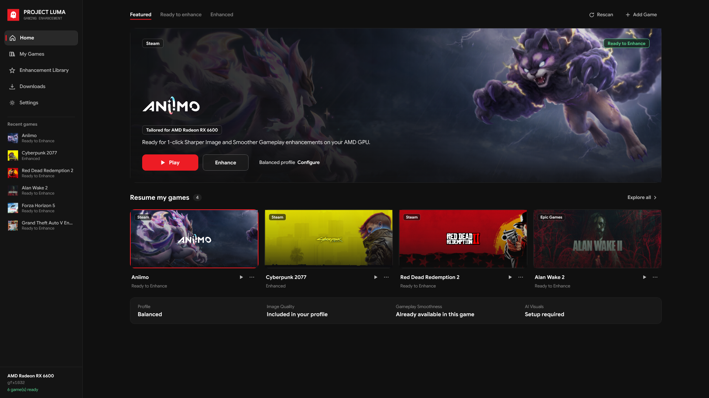

# Project Luma v3.3.0

**Project Luma** is a lightweight, Windows-native AMD gaming enhancement launcher built for Radeon GPUs across **RDNA 1, RDNA 2, RDNA 3, and RDNA 4**. It detects your AMD hardware, discovers games across 8 PC storefronts, configures compatible upscaling and frame-generation profiles with SHA-256 backups, and keeps proprietary or non-commercial dependencies strictly transparent and user-controlled.



---

## What Was Fixed & Added in `v3.3.0`

- **Dedicated NVIDIA Neural Rendering DLL Import & Vault:** Inside **Enhancement Library -> AI Neural Rendering Engine -> View details -> NVIDIA Neural Rendering Model**, users can select **CC** (`>= 310.9.16.0`) or **HT** (`>= 310.8.0.0`), run static non-executing PE32+/x64/version/SHA-256/signature validation, scan game folders or Downloads (`depth <= 3`), open the versioned DLL Vault (`%LocalAppData%\ProjectLuma\UserComponents\NVIDIA\DLSS-NR\<version>`), re-verify, or remove copies — strictly separate from **Import Official Archive**, and integrated with **NeuralHub `v0.9.0`** handoff detection.
- **Functional AI Visuals Dependency Detection (`Find Required Components`):** Replaced no-op setup behavior with a 7-stage asynchronous scan that discovers local candidates (`Use This File`), checks `NeuralHub` runtime binaries (rejecting source-only docs archives), probes initialized HIP vs missing `amdhip64_7.dll`, and never silently resets `EnableNeuralRendering`.
- **Persistent FSR Quality Presets & `OptiScaler.ini` Generation:** Two-way Game Hub bindings save `Quality`, `Balanced`, `Performance`, `UltraPerformance`, and `NativeAA` presets to SQLite across navigation, re-evaluation, and restarts, emitting `[FSR]` and `[QualityOverrides]` keys directly into `OptiScaler.ini`.
- **Truthful Gameplay Smoothness State:** Games with built-in Frame Generation display **Already available in this game** alongside native FG instructions instead of `"Ready"`; DX12 titles without native FG allow toggling OptiFG / FSR-FG; RX 6000 (`RDNA2`) blocks `DLSS-NR-on-AMD v0.9.0` DLSS Frame Generation; DX11/Vulkan titles guide cleanly to Adrenalin AFMF 2.
- **Reliable Windows Tray, Startup & Non-Blocking Downloads:** Added native `NotifyIcon` minimize-on-close, `Open Project Luma` / `Exit Project Luma` context menu, and `TaskbarCreated` Explorer recovery; verified `HKCU\Software\Microsoft\Windows\CurrentVersion\Run\ProjectLuma` registration with upgrade/uninstall sync; moved disk scans off the UI thread with 25-second redirect timeouts and cancellable `.7z` extraction; and added explicit confirmation in `ProjectLuma-Uninstall.exe`.

---

## Documentation & Guides

- User Manual: [PROJECT_LUMA_USER_GUIDE.md](docs/PROJECT_LUMA_USER_GUIDE.md)
- Neural Rendering DLL Import: [NEURAL_RENDERING_DLL_IMPORT_GUIDE.md](docs/NEURAL_RENDERING_DLL_IMPORT_GUIDE.md)
- Feature Engineering Notes: [AI_VISUALS_SETUP.md](docs/AI_VISUALS_SETUP.md), [FSR_PRESET_PERSISTENCE.md](docs/FSR_PRESET_PERSISTENCE.md), [GAMEPLAY_SMOOTHNESS.md](docs/GAMEPLAY_SMOOTHNESS.md), [SYSTEM_TRAY.md](docs/SYSTEM_TRAY.md), [WINDOWS_STARTUP.md](docs/WINDOWS_STARTUP.md), [DOWNLOAD_RELIABILITY.md](docs/DOWNLOAD_RELIABILITY.md)
- Verification & Quality Reports: [REAL_GAME_TEST_REPORT.md](docs/REAL_GAME_TEST_REPORT.md), [FINAL_REGRESSION_REPORT.md](docs/FINAL_REGRESSION_REPORT.md), [KNOWN_LIMITATIONS.md](docs/KNOWN_LIMITATIONS.md)

---

## License & Hardware Honesty

- **No Bundled Proprietary or Non-Commercial Binaries:** Release packages NEVER include proprietary NVIDIA DLLs (`nvngx_*.dll`) or `DLSS-NR-on-AMD` binaries. Official open-source `OptiScaler` (`GPL-3.0`) releases download on demand from `https://github.com/OptiScaler/OptiScaler/releases` with SHA-256 verification.
- **RDNA 2 (`AMD Radeon RX 6600 / gfx1032`) Disclosure:** Official AMD Windows HIP SDK `7.2` documentation excludes `gfx1032`. On the tested RX 6600 host (`Adrenalin 26.11.2`), `amdhip64_6.dll` (`10.0.3652.0`) initializes cleanly while `amdhip64_7.dll` is absent, and DLSS Frame Generation (`DLSS-NR-on-AMD v0.9.0`) + Ray Reconstruction remain unavailable on RX 6000.

---

## Build, Test & Release Commands

```powershell
# Build & run all automated tests (Release, using installed .NET 10 SDK)
& "$env:USERPROFILE\.dotnet\dotnet.exe" test ProjectLuma.sln -c Release

# Build standalone release installer & checksums into release\v3.3.0\
powershell -ExecutionPolicy Bypass -File scripts\build-release.ps1
```
