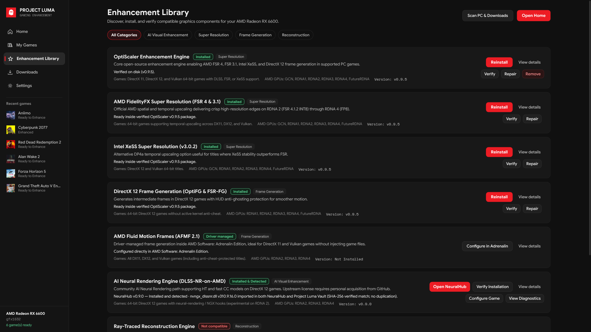

# Project Luma v3.3.1

**Project Luma** is a lightweight, Windows-native AMD gaming enhancement launcher built for Radeon GPUs across **RDNA 1, RDNA 2, RDNA 3, and RDNA 4**. It detects your AMD hardware, discovers games across 8 PC storefronts, configures compatible upscaling and frame-generation profiles with SHA-256 backups, verifies external NeuralHub `v0.9.0` integrations cleanly, and keeps itself updated from official GitHub Releases.



---

## What Was Fixed & Added in `v3.3.1`

- **External NeuralHub `v0.9.0` Detection, DLL Sync & Conflict Protection:** Automatically detects upstream NeuralHub (`HKCU\Software\Danielblnc\NeuralHub` / `%LOCALAPPDATA%\Danielblnc\NeuralHub`, lowercase `neuralhub.exe`, `runtime\v0.9.0\.nh_payload` + `neuralhub_host.dll`, `data\index.ini`), verifies SHA-256 sync with Project Luma's DLL Vault without duplicating files, inspects per-game proxy stubs (`games.json`, `neuralhub.ini`, `dlssnr_on_amd.log`) vs OptiScaler conflicts without overwriting user mods, and adds **Open NeuralHub**, **Verify Installation**, **Configure Game**, and **View Diagnostics** actions.
- **Live GitHub Releases Self-Updater (`Downloads & Updates`):** Checks `Subho-XD/Project-Luma` GitHub Releases, validates `SHA256SUMS.txt` / GitHub asset `sha256` digests, streams portable archives safely over allowlisted HTTPS with Zip-Slip guards, and uses out-of-process `ProjectLuma.Updater.exe` with automatic `--health-check` rollback and zero loss of settings, game profiles, Vault DLLs, or backups.
- **All `v3.3.0` Fixes Retained:** Dedicated NVIDIA DLL import & vault, 7-stage AI Visuals discovery, persistent per-game FSR presets (`OptiScaler.ini`), truthful Gameplay Smoothness states (`Already available in this game`), Windows System Tray + `HKCU\...\Run` startup sync, and non-blocking Downloads UI.

---

## Documentation & Guides

- User Manual: [PROJECT_LUMA_USER_GUIDE.md](docs/PROJECT_LUMA_USER_GUIDE.md)
- NeuralHub Integration & Setup: [NEURALHUB_INTEGRATION_DIAGNOSIS.md](docs/NEURALHUB_INTEGRATION_DIAGNOSIS.md), [NEURALHUB_AND_DLL_SETUP_GUIDE.md](docs/NEURALHUB_AND_DLL_SETUP_GUIDE.md), [NEURALHUB_DLL_IMPORT_GUIDE.md](docs/NEURALHUB_DLL_IMPORT_GUIDE.md)
- Feature Engineering Notes: [FRAME_GENERATION_STATE.md](docs/FRAME_GENERATION_STATE.md), [SYSTEM_TRAY_VERIFICATION.md](docs/SYSTEM_TRAY_VERIFICATION.md), [WINDOWS_STARTUP_VERIFICATION.md](docs/WINDOWS_STARTUP_VERIFICATION.md), [DOWNLOAD_RELIABILITY.md](docs/DOWNLOAD_RELIABILITY.md)
- Verification & Release Reports: [GITHUB_BASELINE_RELEASE.md](docs/GITHUB_BASELINE_RELEASE.md), [REAL_GAME_TEST_REPORT.md](docs/REAL_GAME_TEST_REPORT.md), [KNOWN_LIMITATIONS.md](docs/KNOWN_LIMITATIONS.md)

---

## License & Hardware Honesty

- **No Bundled Proprietary or Non-Commercial Binaries:** Release packages NEVER include proprietary NVIDIA DLLs (`nvngx_*.dll`, `nr-*.dll`) or `DLSS-NR-on-AMD` binaries. Official open-source `OptiScaler` (`GPL-3.0`) releases download on demand from `https://github.com/OptiScaler/OptiScaler/releases` with SHA-256 verification.
- **RDNA 2 (`AMD Radeon RX 6600 / gfx1032`) Disclosure:** Official AMD Windows HIP SDK `7.2` documentation excludes `gfx1032`. On the tested RX 6600 host (`Adrenalin 26.11.2`), `amdhip64_6.dll` (`10.0.3652.0`) initializes cleanly while `amdhip64_7.dll` is absent, and DLSS Frame Generation (`DLSS-NR-on-AMD v0.9.0`) + Ray Reconstruction remain unavailable on RX 6000.

---

## Build, Test & Release Commands

```powershell
# Build & run all automated tests (Release, using installed .NET 10 SDK)
& "$env:USERPROFILE\.dotnet\dotnet.exe" test ProjectLuma.sln -c Release

# Build standalone release installer, portable updater archive & checksums into release\v3.3.1\
powershell -ExecutionPolicy Bypass -File scripts\build-release.ps1
```
