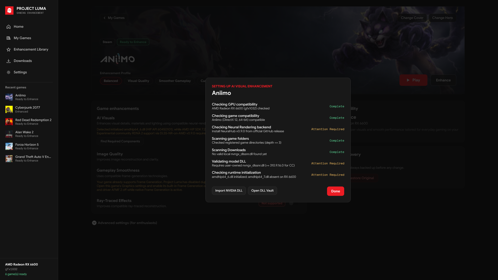

# AI Visuals Automatic Dependency Detection (`v3.3.0`)

## What Was Fixed

Prior builds displayed an inactive `AI Visuals` toggle or silently forced `EnableNeuralRendering = false` when required upstream files were missing. In `v3.3.0`:

1. **Actionable Setup Entry Point (`GameDetailsView`):** Whenever `ShowFindRequiredComponents` is true (64-bit game without a blocking anti-cheat constraint and Neural Rendering not yet ready/active), a `Find Required Components` button is shown directly beneath `AI Visuals`.
2. **Real 7-Stage Discovery Pipeline (`IntelligentComponentResolver.ExecuteAiVisualsDiscoveryAsync`):**
   - `Checking GPU compatibility` — checks architecture and RX 6000 (`gfx1032`) constraints.
   - `Checking game compatibility` — checks DirectX 12, 64-bit PE, native neural/DLSS hooks, and anti-cheat status.
   - `Checking Neural Rendering backend` — inspects `NeuralHubDetector.Detect(...)` and runtime binary payloads (`HasRuntimeBinaryPayload`), never mistaking source-only archives (`README.md`, `LICENSE`) for installed NeuralHub binaries.
   - `Scanning game folders` — bounded scan (`depth <= 3`) across registered game directories for `nvngx_dlssnr.dll`.
   - `Scanning Downloads` — bounded scan (`depth <= 3`) across `%USERPROFILE%\Downloads`.
   - `Validating model DLL` — static PE32+, architecture, `FileVersionInfo` (`CC >= 310.9.16.0`, `HT >= 310.8.0.0`), SHA-256, and Authenticode inspection via [UserDllVault.cs](file:///F:/AI/Project%20Luma/src/ProjectLuma.PackageManager/UserDllVault.cs).
   - `Checking runtime initialization` — checks live HIP runtime probe (`amdhip64_6.dll` vs missing `amdhip64_7.dll` on RDNA 2).
3. **Interactive Candidate Adoption & No Silent Switch-Off:** Any compatible candidate DLL discovered during the scan appears in `DiscoveredSetupCandidates` inside [MainWindow.xaml](file:///F:/AI/Project%20Luma/src/ProjectLuma.UI/MainWindow.xaml) with a `Use This File` button plus quick `Import NVIDIA DLL` and `Open DLL Vault` actions. When setup cannot proceed yet, blockers are shown explicitly rather than silently unchecking `EnableNeuralRendering`.

## NeuralHub v0.9.0 Handoff Policy

Per the upstream `DLSS-NR-on-AMD` `v0.9.0` license (`Custom-Personal-NonCommercial`), Project Luma does not bundle, patch, or modify `NeuralHub_v0.9.0_setup.exe` or copy `nvngx_dlssnr.dll` into game folders without user-configured NeuralHub integration. Instead, [DlssNeuralRenderingAdapter.cs](file:///F:/AI/Project%20Luma/src/ProjectLuma.BackendManager/DlssNeuralRenderingAdapter.cs) records a clear vault-to-NeuralHub handoff note when no documented target binary deployment applies.
