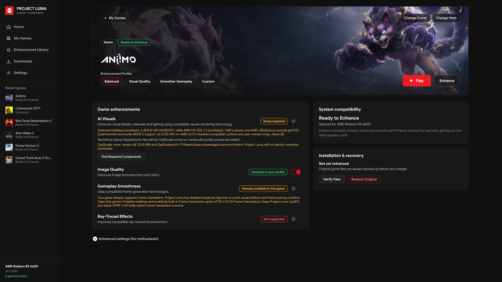

# Gameplay Smoothness & Frame Generation Availability (`v3.3.1`)

## State Matrix

Evaluated in [CapabilityEngine.cs](file:///F:/AI/Project%20Luma/src/ProjectLuma.Compatibility/CapabilityEngine.cs) and [GameCardViewModel.cs](file:///F:/AI/Project%20Luma/src/ProjectLuma.UI/ViewModels/GameCardViewModel.cs):

| Scenario | UI Badge | Toggle Enabled | Explanation & Behavior |
|---|---|---|---|
| **Native Frame Generation Present** | `Already available in this game` | No (`false`) | Suppresses duplicate OptiFG injection (`DoubleFgGuardTriggered = true`) and instructs user to enable native FG inside game settings. |
| **DX12 Game Without Native FG** | `Ready` / `Included in your profile` | Yes (`true`) | Enables OptiScaler `OptiFG DX12 + HUDfix` or `AMD FSR Frame Generation` and writes `[FrameGen]` into `OptiScaler.ini`. |
| **RX 6000 + DLSS-FG Selected** | `Unavailable on RX 6600` (`Unsupported`) | No (`false`) | `DLSS-NR-on-AMD v0.9.0` excludes RX 6000 (`RDNA2`) for DLSS Frame Generation; directs user to FSR FG / OptiFG. |
| **DX11 or Vulkan Game** | `Use AMD Adrenalin AFMF 2` | No (`false`) | Directs user to driver-level AMD Fluid Motion Frames 2 inside Adrenalin. |
| **32-bit or Kernel Anti-Cheat Game** | `Not supported` (`Unsupported`) | No (`false`) | Blocks injection cleanly for account/binary safety. |

Automated regression verified in `GameplaySmoothness_EnforcesNativeFgGuide_OptiFgReady_Rx6000DlssFgBlock_And_Dx11VulkanAfmf` ([RepairAndReleaseReadinessTests.cs](file:///F:/AI/Project%20Luma/tests/ProjectLuma.Tests/RepairAndReleaseReadinessTests.cs)).
