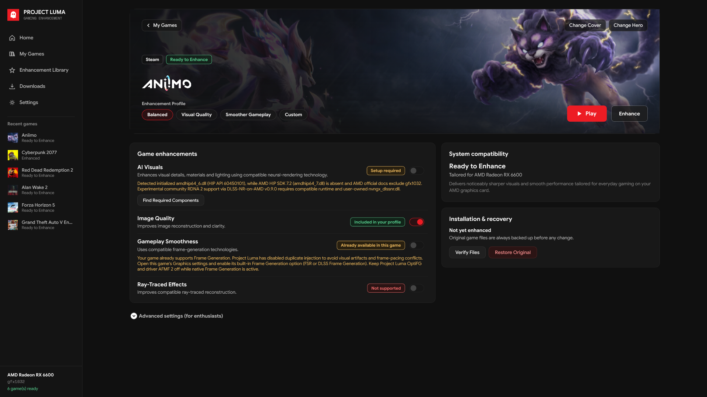

# Gameplay Smoothness State & Availability (`v3.3.0`)

## Three Clear Evaluation Cases

Implemented across [CapabilityEngine.cs](file:///F:/AI/Project%20Luma/src/ProjectLuma.Compatibility/CapabilityEngine.cs) and [GameCardViewModel.cs](file:///F:/AI/Project%20Luma/src/ProjectLuma.UI/ViewModels/GameCardViewModel.cs) and surfaced in [GameDetailsView.xaml](file:///F:/AI/Project%20Luma/src/ProjectLuma.UI/Views/GameDetailsView.xaml):

| Case | Condition | Status Badge | Toggle State | Shown Explanation |
|---|---|---|---|---|
| **Case A** | Game includes native Frame Generation (`NativeFrameGenSupported == true`) | `Already available in this game` (`SupportedWithLimitations`) | Disabled (`false`) | `DoubleFgWarning` + `NativeFrameGenGuide` instructing the user to enable built-in FG in-game and keep OptiFG / AFMF 2 off to avoid frame-pacing conflicts |
| **Case B** | 64-bit DX12 title without native FG, compatible backend (`OptiFG DX12 + HUDfix` / `AMD FSR Frame Generation`) | `Ready` or `Included in your profile` | Enabled (`true`) | Persists on toggle and writes `[FrameGen]` to `OptiScaler.ini` |
| **Case C1** | User selects `DLSS Frame Generation` on RX 6000 (`RDNA2`) | `Unavailable on RX 6000` (`Unsupported`) | Disabled (`false`) | Discloses `DLSS-NR-on-AMD v0.9.0` unavailability on RX 6000 and recommends FSR FG / OptiFG |
| **Case C2** | DirectX 11 or Vulkan game without native FG (or `AFMF` selected) | `Use AMD Adrenalin AFMF 2` | Disabled (`false`) | Guides user to driver-level AMD Fluid Motion Frames 2 |
| **Case C3** | 32-bit executable or blocked anti-cheat | `Not supported` (`Unsupported`) | Disabled (`false`) | Explains OS/binary or anti-cheat restriction |

Note also that Unreal Engine games storing DLSS/DLSS-G plugins under `Engine\Plugins\Runtime` (such as `Bright Memory: Infinite`) are now discovered via bounded depth-5 scan in [GameDirectoryInspector.cs](file:///F:/AI/Project%20Luma/src/ProjectLuma.GameDiscovery/GameDirectoryInspector.cs).
