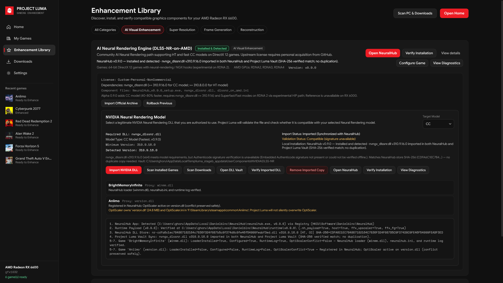

# NeuralHub v0.9.0 & Neural Rendering Setup Guide (`v3.3.1`)

## 1. Installing Upstream NeuralHub v0.9.0

Because the `danielblnc/DLSS-NR-on-AMD` license forbids third-party redistribution or bundling:
1. Open the official release page (`https://github.com/danielblnc/DLSS-NR-on-AMD/releases/tag/v0.9.0`) via **Enhancement Library -> Official Release** if not installed yet.
2. Run `NeuralHub_v0.9.0_setup.exe`. By default it installs to `%LOCALAPPDATA%\Danielblnc\NeuralHub\` (`runtime\v0.9.0\`) and registers `HKCU\Software\Danielblnc\NeuralHub`.
3. Project Luma `v3.3.1` automatically detects the installed runtime and switches `AI Neural Rendering Engine (DLSS-NR-on-AMD)` to **`Installed & Detected`** (`Version: v0.9.0`).

---

## 2. Managing NeuralHub Directly from Project Luma

Once detected in **Enhancement Library**, Project Luma hides redundant download/reinstall prompts and exposes four dedicated controls:
- **Open NeuralHub:** Launches `%LOCALAPPDATA%\Danielblnc\NeuralHub\neuralhub.exe`.
- **Verify Installation:** Clears cached probe state and re-inspects the executable, `.nh_payload`, `neuralhub_host.dll`, `ffx\` libraries, `data\index.ini`, Project Luma Vault SHA-256 match, and registered game directories.
- **Configure Game:** Navigates to the game's **Game Hub** and surfaces any active OptiScaler proxy conflict before changes are made.
- **View Diagnostics:** Expands a read-only 7-state diagnostic panel listing exact paths, SHA-256 match status, and per-game loader/configuration/log verification.

---

## 3. Coexistence with OptiScaler (`version.dll` / `winmm.dll`)

Project Luma never silently overwrites an active OptiScaler installation (`OptiScaler.ini` + large `version.dll`/`dxgi.dll`) inside a game folder:
- Example verified on host: **`Bright Memory: Infinite`** uses NeuralHub proxy stub `winmm.dll` (`96,768` bytes) + `neuralhub.ini` + `dlssnr_on_amd.log` and reports full readiness.
- **`Aniimo`** already has OptiScaler deployed on `version.dll` (`24.8 MB` + `OptiScaler.ini`); Project Luma surfaces this conflict explicitly so you choose cleanly between OptiScaler and NeuralHub per game.
