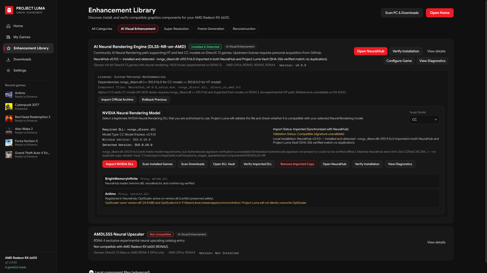

# NVIDIA Neural Rendering DLL Import & Vault Sync Guide (`v3.3.1`)

## 1. Two Compatible Local Stores — Zero Forced Duplication

Project Luma `v3.3.1` inspects both:
1. **Project Luma Local DLL Vault:** `%LOCALAPPDATA%\ProjectLuma\UserComponents\NVIDIA\DLSS-NR\<version>\nvngx_dlssnr.dll`
2. **NeuralHub DLL Store Index:** `%LOCALAPPDATA%\Danielblnc\NeuralHub\data\index.ini` (`[nr]` section -> `File=nr-<sha256>.dll`, `Sha256=`, `FileVersion=`, `Models=`)

When both stores hold an identical copy (verified by SHA-256), Project Luma displays **`Imported (Synchronized with NeuralHub)`** and leaves files in place without duplicating them. If only NeuralHub already has `nvngx_dlssnr.dll` imported, Project Luma recognizes it directly as satisfied for requirement checks (`IntelligentComponentResolver` & `CapabilityEngine`).

---

## 2. Version Requirements (`DLSS-NR-on-AMD v0.9.0`)

| Neural Rendering Model | Minimum `nvngx_dlssnr.dll` Version | Architecture Scope |
|---|---|---|
| **CC Model (Fastest, v0.9.0)** | `310.9.16.0` or newer (`PE32+ x64`) | RDNA 2 / RDNA 3 / RDNA 4 (`Fast` / `Superfast` on RX 6000) |
| **HT Model (Standard)** | `310.8.0.0` or newer (`PE32+ x64`) | RDNA 2 / RDNA 3 / RDNA 4 |

---

## 3. Importing or Verifying via Native Windows File Picker

Under **Enhancement Library -> AI Neural Rendering Engine -> View details -> NVIDIA Neural Rendering Model**:
- **Import NVIDIA DLL:** Opens the native Windows Open File dialog prompting to select a legitimate `nvngx_dlssnr.dll` you are authorized to use, validates PE32+ x64 headers, file version, and model threshold before storing under `%LOCALAPPDATA%\ProjectLuma\UserComponents\NVIDIA\DLSS-NR\`.
- **Scan Installed Games / Scan Downloads:** Bounded depth `<= 3` discovery across detected game roots and Downloads.
- **Open DLL Vault / Verify Imported DLL / Remove Imported Copy:** Inspect folder, recompute SHA-256 + PE32+ check, or remove Project Luma Vault's local copy without touching NeuralHub's external `data\` store.
