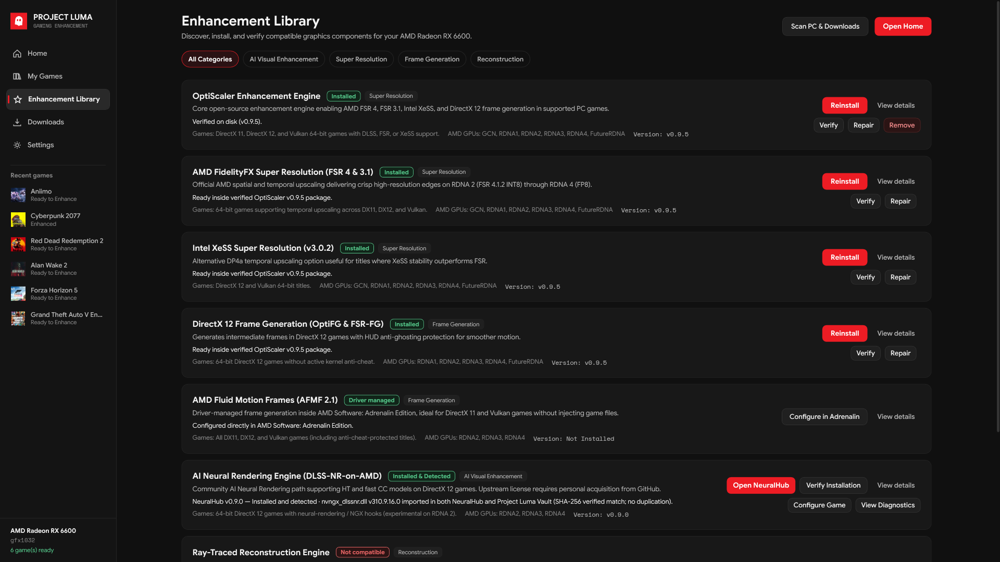

# NeuralHub v0.9.0 Integration Root-Cause Diagnosis & Repair (`v3.3.1`)

## 1. Root Causes Found in Baseline `v3.3.0`

When NeuralHub (`danielblnc/DLSS-NR-on-AMD` v0.9.0) was installed on Windows using the official `NeuralHub_v0.9.0_setup.exe` installer, `v3.3.0` erroneously reported **`Version: Not Installed`**, **`Requires attention`**, and **`NeuralHub v0.9.0 handoff still required`** due to five specific defects:

1. **Missed Official Store Location & Registry Key:** `NeuralHubDetector` and `CapabilityEngine.IsNeuralHubInstalledOnSystem()` checked only `%LOCALAPPDATA%\Programs\NeuralHub`, `%LOCALAPPDATA%\NeuralHub`, `%APPDATA%\NeuralHub`, and `%ProgramFiles%\NeuralHub` — never querying `HKCU\Software\Danielblnc\NeuralHub` (`StorePath`, `RuntimePath`, `RuntimeVersion`, `RuntimeAbi`), `%LOCALAPPDATA%\Danielblnc\NeuralHub`, Windows Uninstall registry entries containing `NeuralHub`, or running `neuralhub.exe` processes.
2. **Case / Pattern Mismatch on Executable & Runtime Layout:** The detector looked for `NeuralHub*.exe` at root rather than lowercase `neuralhub.exe` (`0.9.0`) paired with `runtime\v0.9.0\` containing `.nh_payload`, `neuralhub_host.dll`, `ffx\amd_fidelityfx_upscaler_dx12.dll`, and `ffx\amd_fidelityfx_framegeneration_dx12.dll`.
3. **Ignored NeuralHub DLL Index Store (`data\index.ini`):** Even when `nvngx_dlssnr.dll` (`310.9.16.0`, SHA-256 `CDFA6C1EC784867182164C7836F324F087B5C9F374D0C9FE46F54999FEABF3ED`) was already imported inside `%LOCALAPPDATA%\Danielblnc\NeuralHub\data\nr-*.dll` and indexed in `data\index.ini` (`[nr]` section), Project Luma never parsed `index.ini` or compared hashes against Project Luma's Vault.
4. **No Per-Game Loader vs OptiScaler Conflict Inspection:** Project Luma did not inspect `%LOCALAPPDATA%\Danielblnc\NeuralHub\games.json` or check whether a registered game folder held a NeuralHub proxy stub + `neuralhub.ini` + `dlssnr_on_amd.log` vs an active OptiScaler installation (`OptiScaler.ini` + multi-MB proxy DLL).
5. **External Directory Deletion Risk:** `GitHubPackageManager.RemoveBackendAsync` lacked `ArchiveExistingActive`'s external-path boundary check, risking deletion if `StagedInstallPath` referenced a path outside `%LOCALAPPDATA%\ProjectLuma\backends`.

---

## 2. Implemented Architectural Fix (`v3.3.1`)

- **Shared Read-Only `NeuralHubInspector` ([NeuralHubInspector.cs](file:///F:/AI/Project%20Luma/src/ProjectLuma.Core/Services/NeuralHubInspector.cs)) & Facade ([NeuralHubDetector.cs](file:///F:/AI/Project%20Luma/src/ProjectLuma.PackageManager/NeuralHubDetector.cs)):**
  - Single shared discovery & verification pipeline used by `GitHubPackageManager`, `CapabilityEngine`, `IntelligentComponentResolver`, `UpdateCoordinatorService`, `BackendComponentItem`, and `MainViewModel` (duplicated detection logic removed).
  - Evaluates all **7 independent states** without modifying, duplicating, or deleting any files:
    1. NeuralHub application detected (`neuralhub.exe`, version, discovery source)
    2. Runtime payload verified (`runtime\v0.9.0\.nh_payload`, `neuralhub_host.dll`, bundled FFX DLLs)
    3. NeuralHub DLL imported (`data\index.ini` `[nr]` file, SHA-256, `FileVersion`, `Models`)
    4. Project Luma DLL Vault status & SHA-256 comparison (matches without duplication)
    5. Per-game NeuralHub stub loader installed (`proxy` DLL + conflict differentiation)
    6. Per-game NeuralHub configuration present (`neuralhub.ini`)
    7. Per-game runtime log initialized (`dlssnr_on_amd.log` / `neuralhub_stub.log`)
- **Host Safety Guard:** `GitHubPackageManager.RemoveBackendAsync` refuses to delete directories outside `StagingRootDirectory`, and `BackendComponentItem` hides internal `Verify`/`Repair`/`Remove` and redundant `Official Release`/`Locate Local Copy` prompts when external NeuralHub is detected, exposing **[Open NeuralHub]**, **[Verify Installation]**, **[Configure Game]**, and **[View Diagnostics]**.
- **Performance Optimization:** `DiscoverStoreCandidates` yields lazily and `InspectHostQuickCached()` uses a 2-second thread-safe TTL cache (bypassed via `InvalidateCache()` on explicit verification), keeping 1,000-game capability evaluation at `8 ms` (`< 500 ms` threshold).

---

## 3. Verified Live Host Inspection Result (`--dump-diagnostics`)

- **App & Runtime:** `NeuralHub v0.9.0 — Installed and detected` via `Registry (HKCU\Software\Danielblnc\NeuralHub)` (`%LOCALAPPDATA%\Danielblnc\NeuralHub\`, `runtime\v0.9.0\`, `.nh_payload=True`, `neuralhub_host.dll=True`, `ffx_upscaler=True`, `ffx_fg=True`).
- **DLL Vault Sync:** `nvngx_dlssnr.dll v310.9.16.0` (`[HT, CC]`) imported in both NeuralHub (`data\nr-cdfa6c1ec...dll`) and Project Luma Vault with matching SHA-256 `CDFA6C1EC784867182164C7836F324F087B5C9F374D0C9FE46F54999FEABF3ED` (zero duplication).
- **Games:**
  - `BrightMemoryInfinite`: `LoaderInstalled=True` (`winmm.dll`, `96,768` bytes), `Configured=True` (`neuralhub.ini`), `RuntimeLog=True` (`dlssnr_on_amd.log`), `OptiScalerConflict=False`.
  - `Aniimo`: Registered in `games.json` (`proxy=version.dll`, `key=steam:4126040`), `OptiScalerConflict=True` (`version.dll` `26,052,912` bytes + `OptiScaler.ini`), preserved untouched without silent overwrite.
