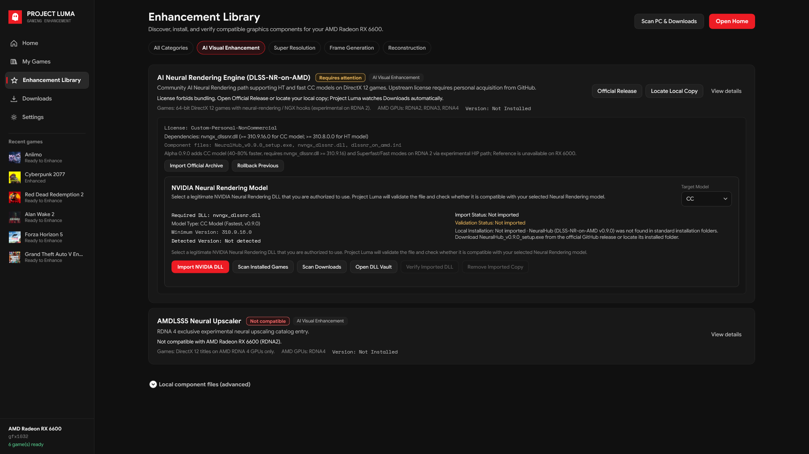

# NVIDIA Neural Rendering DLL Import Guide (`v3.3.0`)

## Legal & License Boundary

Project Luma **never** bundles, downloads from third-party DLL sites, mirrors, or modifies proprietary NVIDIA libraries (`nvngx_dlssnr.dll`, `nvngx_dlss.dll`, `nvngx_dlssg.dll`, `nvngx_dlssd.dll`) or non-commercial `DLSS-NR-on-AMD` binaries (`NeuralHub_v0.9.0_setup.exe`). You must supply only legitimate copies you are already authorized to use on your own PC (for example, from a game you own or an official SDK), and acquire `DLSS-NR-on-AMD` `v0.9.0` directly from its upstream release page:

- `https://github.com/danielblnc/DLSS-NR-on-AMD/releases/tag/v0.9.0`

---

## Version Requirements (`DLSS-NR-on-AMD v0.9.0`)

Requirements are stored in [neural_rendering_requirements.json](file:///F:/AI/Project%20Luma/data/backend_manifests/neural_rendering_requirements.json) and enforced dynamically:

| Neural Rendering Model | Required DLL | Minimum Version | RDNA 2 / RX 6600 Notes |
|---|---|---|---|
| **CC Model (Fastest, v0.9.0)** | `nvngx_dlssnr.dll` | **`310.9.16.0`** | 40–80% faster in `v0.9.0`; requires `>= 310.9.16.0` |
| **HT Model (Standard)** | `nvngx_dlssnr.dll` | **`310.8.0.0`** | Requires `>= 310.8.0.0`; `Reference` mode unavailable on RX 6000 |

- **HIP Runtime Note on RX 6600 (`gfx1032`):** Upstream `DLSS-NR-on-AMD v0.9.0` notes installing AMD HIP SDK 7.2 if a missing HIP runtime is reported, while AMD's official Windows HIP SDK 7.2 documentation excludes `gfx1032`. On the verified RX 6600 host, Adrenalin's `amdhip64_6.dll` (`10.0.3652.0`) initializes `1` HIP device while `amdhip64_7.dll` is absent — Project Luma reports this status explicitly without overclaiming official AMD HIP 7.2 support.

---

## Step-by-Step: Importing `nvngx_dlssnr.dll`

1. Open **Enhancement Library** in the left navigation bar.
2. Locate **AI Neural Rendering Engine (DLSS-NR-on-AMD)** and click **View details**.
3. Scroll to **NVIDIA Neural Rendering Model** (separate from **Import Official Archive**, which is only for importing a downloaded upstream archive):
   - Choose your target model (**CC** or **HT**).
   - Use **Import NVIDIA DLL** to open the native Windows file picker (`nvngx_dlssnr.dll`) from Downloads, a game folder, or a custom directory.
   - Or click **Scan Installed Games** / **Scan Downloads** (bounded recursion `depth <= 3`, cancellable) and click **Use This File** on a validated candidate.
4. Project Luma performs **static (non-executing) validation** checking:
   - Filename match (`nvngx_dlssnr.dll`)
   - Readability & Windows PE32+ DLL headers
   - 64-bit x64 architecture (`AMD64`)
   - Embedded version info (including comma-formatted NVIDIA version strings)
   - SHA-256 digest & optional Authenticode signature (explicitly noting when an unsigned or offline-chain binary cannot be signature-verified)
5. Validated files are stored safely without duplicates in:
   - `%LOCALAPPDATA%\ProjectLuma\UserComponents\NVIDIA\DLSS-NR\<version>\nvngx_dlssnr.dll` + `metadata.json`
6. Use **Open DLL Vault**, **Verify Imported DLL**, or **Remove Imported Copy** at any time to inspect, re-verify, or remove your local file. When **NeuralHub** is detected on your PC, click **Open NeuralHub** to complete upstream integration cleanly.
