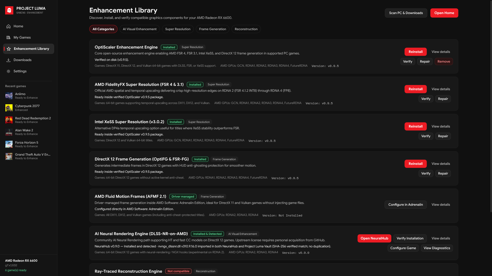

# Project Luma v3.3.1 — User Guide

## 1. Overview & Supported Hardware

Project Luma is a Windows 10/11 (x64) desktop enhancement launcher built for **AMD Radeon RDNA 1, RDNA 2, RDNA 3, and RDNA 4** graphics cards.

- **Verified Hardware Baseline:** `AMD Radeon RX 6600` (`RDNA2` / `gfx1032`, 8 GB VRAM, Adrenalin `26.11.2`, Windows 11 Pro x64).
- **Non-Destructive Backup & Rollback:** Original game files are backed up with SHA-256 manifests before applying enhancements and can be verified or restored cleanly at any time.
- **Anti-Cheat Safety:** Kernel anti-cheat titles (such as `PUBG` and `VALORANT`) remain untouched unless a verified offline mode is supported.

---

## 2. Installing, Live Updating, and Uninstalling

1. **Fresh Install / Repair:** Run `ProjectLuma-Setup-x64.exe` (`Welcome -> System Check -> Install & Finish`).
2. **One-Click Live Updates (`Downloads` Page):** Open **Downloads** and click **Check for Updates**. Project Luma queries the official GitHub Releases API (`Subho-XD/Project-Luma`), verifies `SHA256SUMS.txt` / GitHub asset SHA-256 digests, stages verified archives safely, closes cleanly while `ProjectLuma.Updater.exe` swaps binaries atomically (with automatic rollback if `--health-check` fails), and restarts running the new version while keeping all game profiles, settings, backups, and Vault DLLs intact.
3. **Repair / Uninstall:** Use **Windows Settings -> Apps -> Installed apps -> Project Luma**, or run `ProjectLuma-Uninstall.exe`.

---

## 3. NeuralHub v0.9.0 & AI Visuals Integration

- If upstream NeuralHub (`danielblnc/DLSS-NR-on-AMD v0.9.0`) is installed (`%LOCALAPPDATA%\Danielblnc\NeuralHub`), Project Luma detects the executable, `runtime\v0.9.0` payload, `data\index.ini` (`nvngx_dlssnr.dll`), and `games.json` automatically — displaying **`Installed & Detected`** (`Version: v0.9.0`) without duplicating DLLs or asking to reinstall.
- **Enhancement Library Controls:** Use **Open NeuralHub**, **Verify Installation**, **Configure Game**, or **View Diagnostics** directly on the `AI Neural Rendering Engine` card.
- **Conflict Safety:** If a game already uses OptiScaler (`OptiScaler.ini` + `version.dll`), Project Luma alerts you instead of silently overwriting OptiScaler.
- See [NEURALHUB_AND_DLL_SETUP_GUIDE.md](NEURALHUB_AND_DLL_SETUP_GUIDE.md) and [NEURALHUB_DLL_IMPORT_GUIDE.md](NEURALHUB_DLL_IMPORT_GUIDE.md).

---

## 4. Enhancing Games, System Tray & Startup

- **Image Quality (`OptiScaler`):** Supports FSR 4.1.2 INT8 on RDNA 2, FSR 3.1.2, and Intel XeSS with persistent per-game quality presets (`Quality`, `Balanced`, `Performance`, `UltraPerformance`, `NativeAA`).
- **Gameplay Smoothness:** Surfaces native Frame Generation guidance (`Already available in this game`) cleanly, configures `OptiFG DX12 + HUDfix` / `FSR-FG` where supported, directs DX11/Vulkan games to Adrenalin AFMF 2, and blocks unsupported RX 6000 `DLSS-FG`.
- **Minimize to Tray & Start with Windows (`Settings`):** Keeps Project Luma in the notification area on close and manages `HKCU\Software\Microsoft\Windows\CurrentVersion\Run\ProjectLuma` without administrator prompts.
