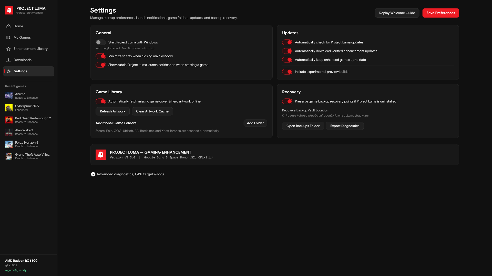

# Start Project Luma with Windows (`v3.3.0`)

## How It Works

1. **Registry Location (No Elevation Required):** [WindowsStartupService.cs](file:///F:/AI/Project%20Luma/src/ProjectLuma.GameInstaller/WindowsStartupService.cs) reads and writes:
   - `HKCU\Software\Microsoft\Windows\CurrentVersion\Run` -> value `ProjectLuma`
   - Stored command format: quoted full executable path `"<installDir>\ProjectLuma.exe"`, verified by registry readback after writing.
2. **Real OS State Synchronization:** On startup ([MainViewModel.cs](file:///F:/AI/Project%20Luma/src/ProjectLuma.UI/ViewModels/MainViewModel.cs)), Project Luma queries `_startupService.IsEnabled()` so the UI toggle and `WindowsStartupStatusText` reflect actual Windows state even if modified externally.
3. **Duplicate Cleanup:** Enabling startup via `WindowsStartupService` removes legacy duplicate `.lnk` shortcuts (`Project Luma.lnk`) from `%APPDATA%\Microsoft\Windows\Start Menu\Programs\Startup`.
4. **Upgrade & Uninstall Sync ([InstallerEngine.cs](file:///F:/AI/Project%20Luma/src/ProjectLuma.Setup/InstallerEngine.cs)):**
   - Upgrading to a new install path automatically updates the `HKCU\...\Run\ProjectLuma` path if startup is enabled (`UpdateExecutablePathIfEnabled`).
   - Uninstalling with registry removal cleans up the startup Run entry (`Disable`).

## Verified Behavior

- Tested end-to-end against an isolated `HKCU\Software\ProjectLumaTest\*` key and temp Startup folder in `WindowsStartupService_RegistersReadsUpdatesAndDisablesHkcuRunEntry` ([RepairAndReleaseReadinessTests.cs](file:///F:/AI/Project%20Luma/tests/ProjectLuma.Tests/RepairAndReleaseReadinessTests.cs)).
